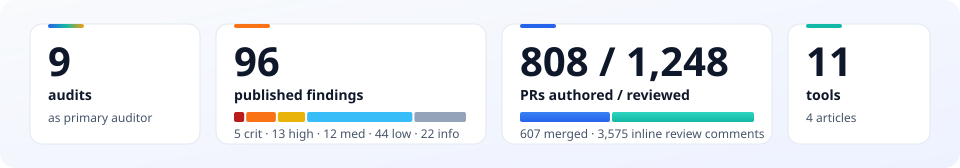
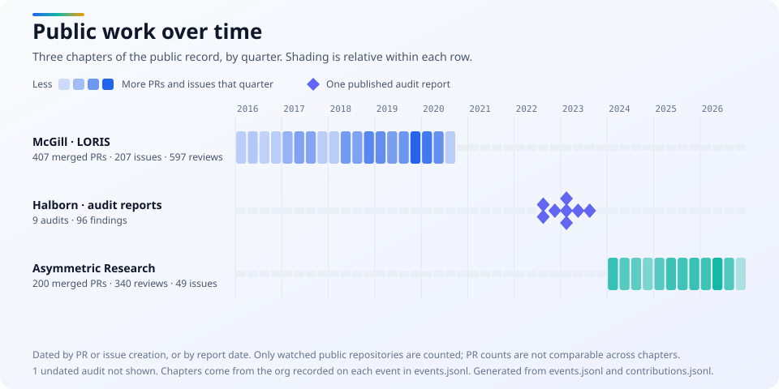
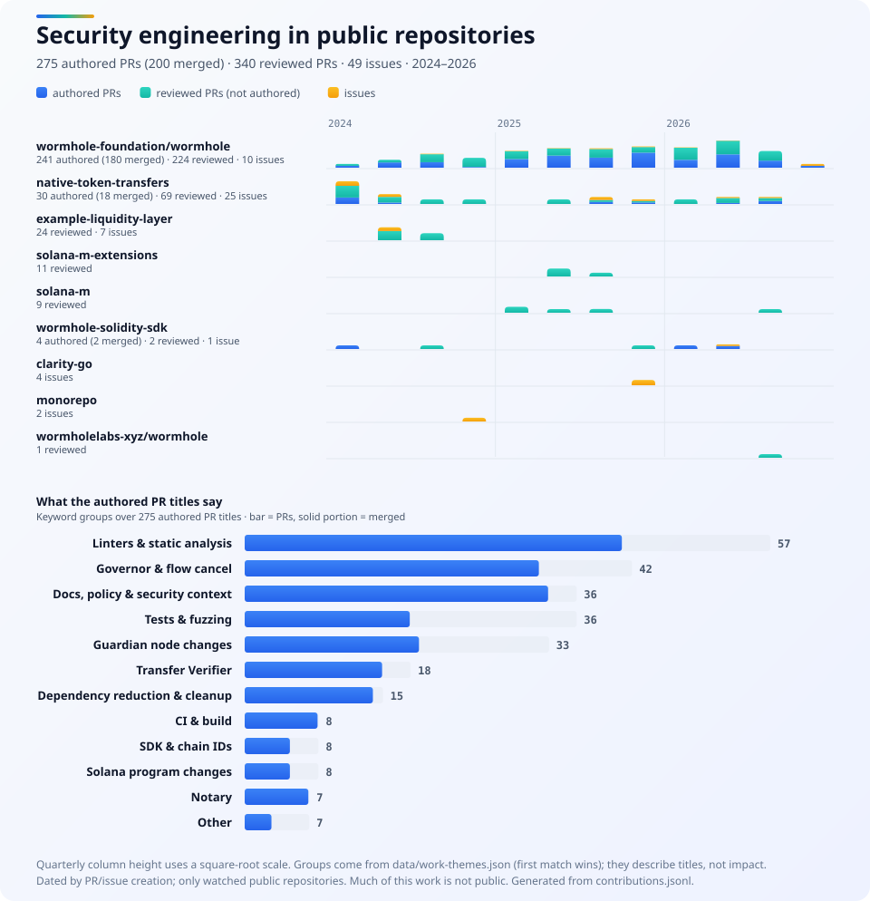
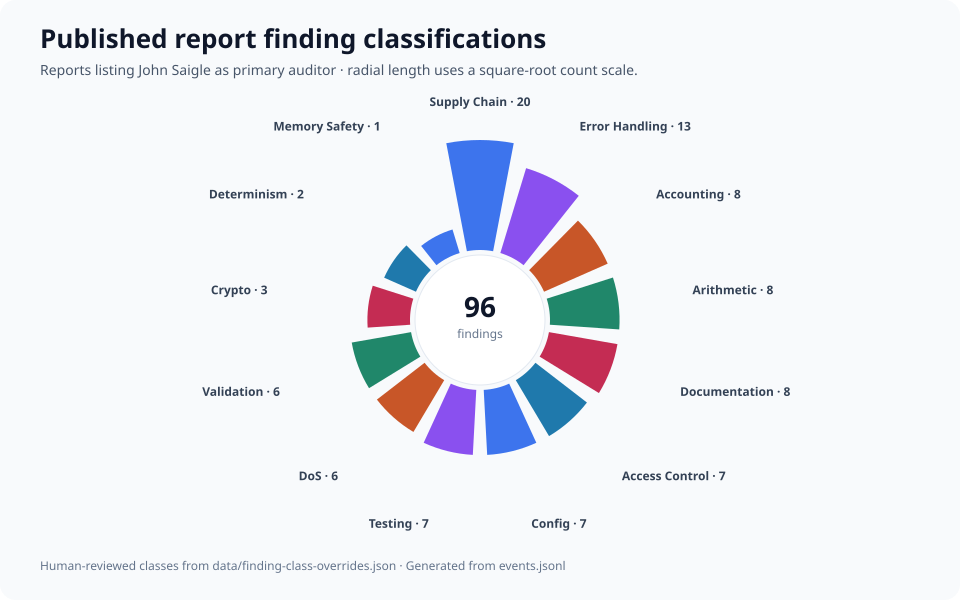

# Overview

This is a loose archive of security work I've done for open-source projects, including
security engineering and source code reviews.

> **Note:** this is a best-effort list of *public* work only. Much of my audit
> and security engineering output is under confidentiality agreement and cannot be listed.

## Selected work

- **Audits:** 9 published reports as primary auditor, including 4 critical findings in ZetaChain Node and 1 critical finding in Groth16 Verifier.
- **Code review:** reviewed 1,248 public pull requests, leaving 3,575 inline comments across 710 of them.
- **Authored:** 808 public pull requests, 607 merged.

| Area | Work | PRs |
| --- | --- | --- |
| Wormhole Guardian | Added the Transfer Verifier mechanism to the Guardian node, integrated it into the Ethereum watcher, and wrote its whitepaper. | [#4169](https://github.com/wormhole-foundation/wormhole/pull/4169), [#4233](https://github.com/wormhole-foundation/wormhole/pull/4233), [whitepaper #4242](https://github.com/wormhole-foundation/wormhole/pull/4242) |
| Wormhole Guardian | Extended Governor flow cancel with a configurable allow-list of chain ID pairs, and added the Notary package for verifying message publications. | [flow cancel #4229](https://github.com/wormhole-foundation/wormhole/pull/4229), [Notary #4315](https://github.com/wormhole-foundation/wormhole/pull/4315) |
| Native Token Transfers | Added fuzzing and overflow checks for TrimmedAmount in the Solana program, and wrote INVARIANTS.md to support security assessments. | [#269](https://github.com/wormhole-foundation/native-token-transfers/pull/269), [#684](https://github.com/wormhole-foundation/native-token-transfers/pull/684) |

## Public work over time

## Security engineering in public repositories

## Findings in published audit reports

Machine-readable exports: [summary](dist/summary.json) · [events](dist/events.json) · [capability graph](dist/capability-graph.json) · [finding patterns](dist/finding-patterns.json)

<!-- GENERATED from events.jsonl by scripts/render.js — do not edit sections below by hand. -->

# Code Review and Security Engineering

## As part of Asymmetric Research

### Wormhole

- [Wormhole Guardian](https://github.com/wormhole-foundation/wormhole/pulls/johnsaigle) (182 merged PRs, 10 issues, 114 reviews in 2026)
- [Review: Canton chain integration](https://github.com/wormholelabs-xyz/wormhole/pull/55)
  Substantial review and design feedback on the Canton integration PR (developed on the WormholeLabs fork).
- [Wormhole Native Token Transfers](https://github.com/wormhole-foundation/native-token-transfers/pulls?q=is%3Apr+author%3Ajohnsaigle) (18 merged PRs, 25 issues, 11 reviews in 2026)
- [Wormhole Liquidity Layer](https://github.com/wormhole-foundation/example-liquidity-layer/pulls?q=johnsaigle) (7 issues)
- [Wormhole Solidity SDK bug reports](https://github.com/wormhole-foundation/wormhole-solidity-sdk/pull/105)

### Stacks

- [Clarity-Go Parser](https://github.com/stx-labs/clarity-go/issues?q=is%3Aissue%20author%3Ajohnsaigle) (4 issues)

### Commonware

- [Commonware monorepo](https://github.com/commonwarexyz/monorepo/issues?q=is%3Aissue%20author%3Ajohnsaigle) (2 issues)

### Other Projects

- [Solana M](https://github.com/m0-platform/solana-m/pulls?q=is%3Apr+AR+is%3Aclosed) (9 merged PRs)
- [Solana M Extensions](https://github.com/m0-platform/solana-m-extensions/pulls?q=is%3Apr+%22AR%22) (11 merged PRs)
- [Solana M: claim yield calculation walked incomplete index history](https://github.com/m0-platform/solana-m/pull/186)

## McGill University (2015-2020)

- [LORIS Neuroimaging Software](https://github.com/aces/Loris/pulls?q=is%3Apr+author%3Ajohnsaigle+is%3Aclosed+label%3A%22Category%3A+Security%22) (407 merged PRs, 207 issues)

## Independent Projects

- [Ghostfolio: insecure randomness for new passwords](https://github.com/ghostfolio/ghostfolio/discussions/3192)
  Password generation used insecure randomness; reported and fixed via PR.
- [node: Upgrade go-libp2p to v0.46.0](https://github.com/wormhole-foundation/wormhole/pull/5070)

# Audit Reports

Formal audit reports for which I was the primary auditor.

| Date | Title | Client | Type | Language | C / H / M / L / I | Report |
| --- | --- | --- | --- | --- | --- | --- |
| 2023-08-06 | Tricorn Bridge Server Security Assessment | BoostyLabs | EVM, Bridge | Go | 0 / 3 / 2 / 10 / 9 | [Report](https://github.com/HalbornSecurity/PublicReports/blob/master/Cosmos%20Audits/BoostyLabs_Tricorn_Bridge_Server_Golang_Security_Assessment_Report_Halborn_Final.pdf) |
| 2023-05-12 | Groth16 Verifier Audit | Mysten Labs (Sui Foundation) | Cryptography, ZK | Rust | 1 / 0 / 1 / 6 / 1 | [Report](https://github.com/johnsaigle/audits/blob/main/pdfs/Groth16.pdf) |
| 2023-03-31 | ZetaChain Node Security Audit | ZetaChain | Cosmos, Bridge, Bitcoin | Go, Solidity | 4 / 5 / 6 / 6 / 0 | [Report](https://drive.google.com/file/d/1323iwH34kOqGzBZIz4iX-Qfo8ACzomNc/view) |
| 2023-01-25 | Maya Node Security Audit | MayaChain | Cosmos, Node | Go | 0 / 2 / 0 / 12 / 4 | [Report](https://maya-cdn.s3.amazonaws.com/Halborn/Cosmos_Security_Final.pdf) |
| 2023-01-18 | Maya Node Liquidity Auction Audit | MayaChain | Cosmos, DeFi | Go | 0 / 2 / 1 / 4 / 2 | [Report](https://maya-cdn.s3.amazonaws.com/Halborn/Liquidity_Auction_Final.pdf) |
| 2022-11-24 | Mars Protocol Custom Modules Audit (Governance, Incentives, Safety) | Mars Protocol | Cosmos, Governance, DeFi | Go | 0 / 1 / 0 / 3 / 3 | [Report](https://github.com/mars-protocol/mars-audits/blob/main/hub/halborn/Mars_Protocol_Custom_Modules_Gov_Incentives_Safety_Cosmos_Security.pdf) |
| 2022-09-08 | Sifchain Margin Audit | Sifchain | Cosmos, DeFi | Go | 0 / 0 / 1 / 1 / 2 | [Report](https://drive.google.com/drive/u/1/folders/1kkjdpNuRmTjaiIKA6CQISavCvj4Awpbc) |
| 2022-07-08 | Sifchain CLP Update Audit | Sifchain | Cosmos, DeFi | Go | 0 / 0 / 1 / 2 / 1 | [Report](https://drive.google.com/drive/u/1/folders/1kkjdpNuRmTjaiIKA6CQISavCvj4Awpbc) |
|  | Maya Node ETH Router Audit | MayaChain | Cosmos, DeFi | Go | n/a | [Report](https://maya-cdn.s3.amazonaws.com/Halborn/ETH_Router_Draft_3.pdf) |

# Technical Writing

Personal website: https://johnsaigle.com

## Asymmetric Research

- [Boredom Over Beauty: Why Code Quality is Code Security](https://blog.asymmetric.com/boredom-over-beauty-why-code-quality-is-code-security/)
- [Solana Vulnerabilities That Aren't — Unpacking Common Misreports](https://blog.asymmetric.com/solana-vulnerabilities-that-arent-unpacking-common-misreports/)

## Halborn

- [Top 5 Security Vulnerabilities Cosmos Developers Need to Watch Out For](https://www.halborn.com/blog/post/top-5-security-vulnerabilities-cosmos-developers-need-to-watch-out-for)
- [Don't “Panic”: How Improper Error-Handling Can Lead to Blockchain Hacks](https://www.halborn.com/blog/post/dont-panic-how-improper-error-handling-can-lead-to-blockchain-hacks)

# Tools

- [locked-in](https://github.com/asymmetric-research/locked-in) -- lint for unsafe package installation patterns
- [go-unmaintained](https://github.com/johnsaigle/go-unmaintained) -- find abandoned packages via go.mod
- [Anchor version detector](https://github.com/johnsaigle/anchor-version-detector)
- [Scary Strings](https://github.com/johnsaigle/scary-strings) -- dangerous-function wordlists
- [skill-issues](https://github.com/johnsaigle/skill-issues) -- prompt injection scanner for markdown and agent files
- [hermit](https://github.com/johnsaigle/hermit) -- linter for curl | bash patterns
- [audit-notes](https://github.com/johnsaigle/audit-notes) -- markdown scaffolding for security audits
- [persona](https://github.com/johnsaigle/persona) -- local-first PII detection and redaction
- [Neovim security/SAST diagnostics integrations](https://github.com/johnsaigle/semgrep-diagnostics.nvim)
- [Oblique Strategies for Hackers](https://github.com/johnsaigle/oblique-strategies-for-hackers)
- [channelcheck](https://github.com/johnsaigle/channelcheck) -- detect dangerous Go channel operations
